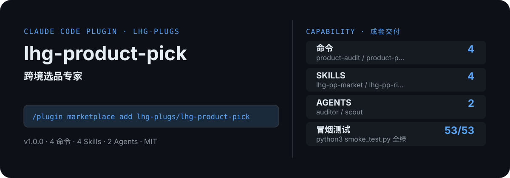

<!-- About 简介（推送后填写到仓库 About 栏）：
跨境选品专家：目标市场定位→五维选品打分表→供应链 checklist→禁售/合规风险清单；只给评估框架与打分表，销量/竞争数据需用户自行从平台后台核实，不做选品成败承诺。 ｜ 一键安装：/plugin marketplace add lhg-plugs/lhg-product-pick
-->
<!-- topics（推送后打）：claude-code, claude-plugin, agent-skills, cross-border, ecommerce, product-selection, amazon, tiktok-shop -->

<p align="center">
  
</p>

> **一句话介绍**：跨境选品专家：目标市场定位→五维选品打分表→供应链 checklist→禁售/合规风险清单；只给评估框架与打分表，销量/竞争数据需用户自行从平台后台核实，不做选品成败承诺。

**一键安装**：在 Claude Code 里运行

```bash
/plugin marketplace add lhg-plugs/lhg-product-pick
/plugin install lhg-product-pick@lhg-plugs
```

## 它能帮你做出什么

- **冒烟全绿**：`python3 smoke_test.py` 53 项全部通过（JSON 合法、frontmatter 完整、命令/skill/agent 齐全）。

## 它是什么

`lhg-product-pick` 是一个 Claude Code 插件（plugin 为主、skill 为辅）：

- **4 个命令**（小白入口）：`product-audit` 选品评估单体检、`product-pick` 跨境选品一条龙、`product-risk` 下单前风险体检、`product-score` 给候选产品打五维分
- **4 个平台中立 skill**（方法论，可移植到豆包/Workbuddy 等 agent 平台）：lhg-pp-market, lhg-pp-risk, lhg-pp-score, lhg-pp-supply
- **2 个专家 agent**：auditor, scout
- **1 个 hooks**（`hooks/`：pre_pick_gate.py），关键操作前自动把关

## 为什么是它

不是一个 prompt，而是一套互相兜底的机制：

1. **硬门，不是提醒**：hooks 在关键操作前自动拦截或警告（见 `hooks/`），而不是只在文档里写一句"请注意"。
2. **方法论沉淀在 skill 里**：流程、检查清单、口径都写在 `skills/` 的方法论里，命令只是入口；换个 agent 平台也能复用同一套做法。
3. **可验，不是可信**：`fixtures/` 备有坏/好对照用例，`smoke_test.py` 一键验证，规则有没有生效、自己跑一遍就知道。

## 快速上手

```bash
# 1. 安装（Claude Code 里运行）
/plugin marketplace add lhg-plugs/lhg-product-pick
/plugin install lhg-product-pick@lhg-plugs

# 2. 跨境选品一条龙：目标市场定位 → 五维打分表 → 供应链 checklist →
/lhg-product-pick:product-pick "厨房收纳盒，美国亚马逊"
```

| 命令 | 作用 | 示例 |
|---|---|---|
| `/lhg-product-pick:product-audit` | 选品评估单体检：跑确定性审计脚本，6 条规则（打分维度/利润公式/物流标注/禁售合规/承诺拦截/数据声明）逐条清零。 | `/lhg-product-pick:product-audit ./我的选品` |
| `/lhg-product-pick:product-pick` | 跨境选品一条龙：目标市场定位 → 五维打分表 → 供应链 checklist → 风险清单 → 输出选品评估报告（附数据… | `/lhg-product-pick:product-pick "厨房收纳盒，美国亚马逊"` |
| `/lhg-product-pick:product-risk` | 下单前风险体检：禁售速查→认证地图→物流三问→知产检查→退货预案，输出带应对动作的风险清单。 | `/lhg-product-pick:product-risk "儿童磁力片" "美国亚马逊"` |
| `/lhg-product-pick:product-score` | 给候选产品打五维分：市场需求/竞争烈度/利润空间/物流适配/合规风险… | `/lhg-product-pick:product-score "硅胶折叠水杯" "TikTok 东南亚"` |

## 什么时候用 / 什么时候不用（FAQ）

**什么时候用：**

- 你需要选品评估单体检时 → 用 `/lhg-product-pick:product-audit`
- 你需要跨境选品一条龙时 → 用 `/lhg-product-pick:product-pick`
- 你需要下单前风险体检时 → 用 `/lhg-product-pick:product-risk`

**什么时候不用：**

- 你只需要其中一个零散能力时 → 本插件是成套流程，单点需求用更轻量的 skill 更合适
- 你希望 AI 完全自由发挥、不接受任何自查与硬门时 → 它的规则审计与 hooks 会介入（可关，但那就别装它）
- 你的场景不在上面命令表覆盖范围内时 → 先看命令表，没有对应命令就别硬套

## 目录结构

```
lhg-product-pick/
├── smoke_test.py          # 一键冒烟测试
├── ATTRIBUTION.md         # 灵感来源与许可声明
├── LICENSE                # MIT
├── README.md              # 本文件
├── .claude-plugin/
├── agents/
├── commands/
├── fixtures/
├── hooks/
├── scripts/
├── skills/
```

## 自检与反馈

本插件自带质检：每次使用后可跑 `python3 smoke_test.py` 一键验证（本次实测 53 项全部通过）。

发现 bug 或有改进建议，以 `[QC] <一句话问题>` 为标题提交到 https://github.com/lhg-plugs/lhg-product-pick/issues，正文写清"复现步骤 → 实际表现 → 期望表现"。

同门插件见 [lhg-plugs](https://github.com/lhg-plugs)，86 个插件的完整矩阵在 [marketplace](https://github.com/lhg-plugs/marketplace) 维护。

## 出品：刘洪光

本插件由真人出镜 IP「刘洪光」（安徽合肥）出品，归属 [lhg-skills](https://github.com/lhg-skills)。

- GitHub 主页：https://github.com/lhg-skills —— 全部 skill 开源在此，欢迎 star
- 抖音：搜「刘老师讲AI实战」
- 微信：lhgsmsw
